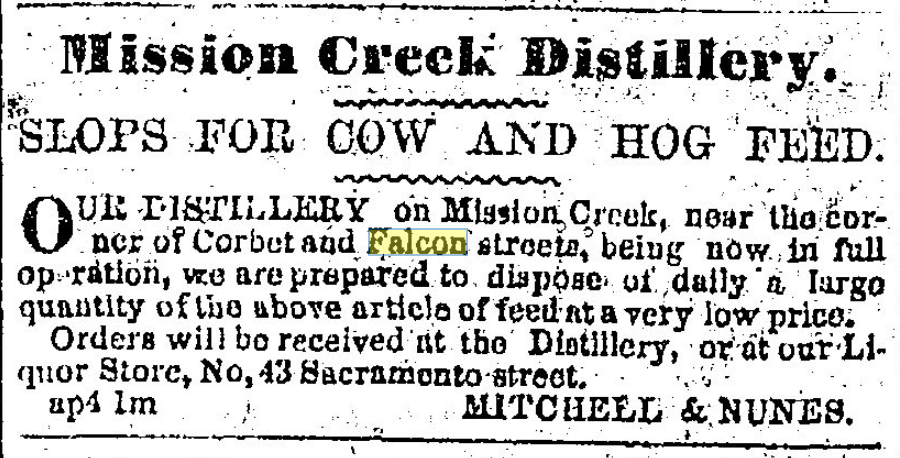
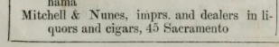
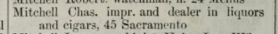
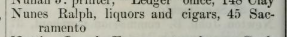
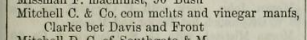

One confusing item I ran across while researching:

Mission Creek Distillery
SLOPS FOR COW AND HOG FEED. –– Our Distillery on Mission Creek, near corner Corbet and Falcon streets, being now in full operation, we are prepared to dispose of daily a large quantity of the above articles of feed, at a very low price.
Orders will be received at the Distillery, or at our Liquor Store, No 43 Sacramento street.

- MITCHELL & NUNES

This is confusing because at no point does Falcon (18th st) cross Corbett (17th st) since they run parallel. It's possible he meant the old Corbett road?

And indeed, [the 1854 directory](https://archive.org/details/lecountstrongssa1854sanf/page/96/mode/1up) has

and

These ads OCR badly, so only can see it from 6 April to 4 May 1854. So maybe it didn't work out?

We don't have an 1855 directory, but in the 1857, we see [Mitchell has gone off on his own](https://archive.org/details/colvillessanfran1856colv/page/153/mode/1up) to become "com[mercial] m[er]ch[an]ts and vinergar man[u]f[acturer]s" I guess? and [Ralph Nunes is not in evidence](https://archive.org/details/colvillessanfran1856colv/page/163/mode/1up).  Or possibly Colville's directory was just very poor quality. (Likely.)

Okay but I still want to know where the distillery premises actually were!

[Looking at the 1860 Langley](https://archive.org/details/sanfranciscodire1860lang/page/228/mode/1up), things get... murkier.

> Mitchell (Charles) & Co. Vinegar, pickles, etc. 18 Sacramento
> Mitchell Charles F. distiller with F. P. McMahon & Co. dwl W s Mason bet Clay and Sac

Either of them could've been our Nunez partner, and Nunes is still missing. We may never know, esp because [the only F. P. McMahon in any of the directories is this guy](https://archive.org/details/sanfranciscodire1860lang/page/221/mode/1up) who is not a distiller:
> McMahon Frederick P. & Co. Fair Haven Oil Works, E s First bet Folsom and Howard, office 80 Front, dwl E s First nr Tehama
