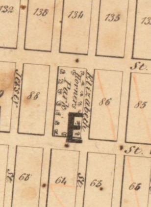
> "Subdivision of blocks in 'H.A.' [Horners Addition] as per map made for John M. Horner by J.J. Gardiner, City & Co. Surveyor, A.D. 1854 on January 1st.": ms. map on sheet 20 x 25.5 cm., mounted on lower half of lithographed map"For particulars refer to large map at J. M. Horners Office, Armory Hall, Montgomery St."  MS notes: Map of Horners addition Rancho de San Miguel or Noe Rancho. A copy of this map filed at the request of A. C. Thayer Nov 11, 63, 22 min past 10 O'clock. Rbbs 173 to 180 are now located on the new maps of the City....  Prime meridian: GM.  Relief: no.  Graphic Scale: Feet.  Projection: Cylindrical.  Printing Process: Lithography.  Verso Text: MS notes: 442362 Horners Addition.
[Map of San Francisco with Horners Addition](https://hdl.huntington.org/digital/collection/p15150coll4/id/3502/)

[Daily Placer Times and Transcript - January 10, 1854](https://infoweb-newsbank-com.ezproxy.sfpl.org/apps/news/openurl?ctx_ver=z39.88-2004&rft_id=info%3Asid/infoweb.newsbank.com&svc_dat=EANX-NB&req_dat=C4A791F4197B4BD28C27A2A6A0C93929&rft_val_format=info%3Aofi/fmt%3Akev%3Amtx%3Actx&rft_dat=document_id%3Aimage%252Fv2%253A11B56327F72F7EE7%2540EANX-NB-11BE41F06A163738%25402398229-11BE41F097B82C90%25402-11BE41F12843C510%2540Advertisement/hlterms%3A%2522horner%2527s%2520addition)
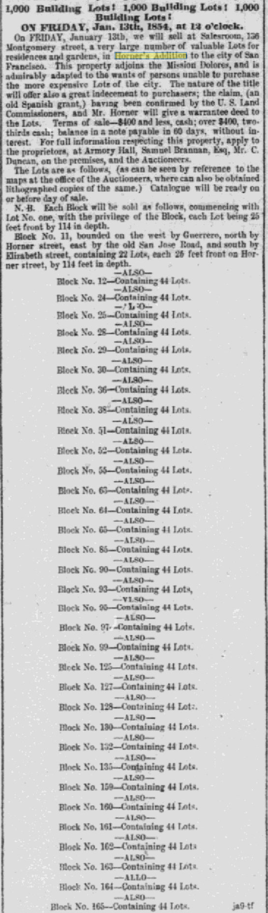
> 1,000 Building Lots! 1,000 Building Lots! 1,000 Building Lots!
> ON FRIDAY, Jan. 13th, 1854, at 12 o'clock.
> On FRIDAY, January 13th, we will sell at Salesroom, 136 Montgomery street, a very large number of valuable Lots for residences and gardens, in Horner's Addition to the city of San Francisco. This property adjoins the Mission Dolores, and is admirably adapted to the wants of persons unable to purchase the more expensive Lots of the city. The nature of the title will offer also a great inducement to purchasers; the claim, (an old Spanish grant,) having been confirmed by the U. S. Land Commissioners, and Mr. Horner will give a warrantee deed to the Lots. Terms of sale—$400 and less, cash; over $400, two-thirds cash; balance in a note payable in 60 days, without interest. For full information respecting this property, apply to the proprietors, at Armory Hall, Samuel Brannan, Esq, Mr. C. Duncan, on the premises, and the Auctioneers.
> The Lots are as follows, (as can be seen by reference to the maps at the office of the Auctioneers, where can also be obtained lithographed copies of the same.) Catalogue will be ready on or before day of sale.
> N. B. Each Block will be sold as follows, commencing with Lot No. one, with the privilege of the Block, each Lot being 25 feet front by 114 in depth.
> Block No. 11, bounded on the west by Guerrero, north by Horner street, east by the old San Jose Road, and south by Elizabeth street, containing 22 Lots, each 25 feet front on Horner street, by 114 feet in depth.
"Advertisement." Daily Placer Times and Transcript (San Francisco, California) V, no. 1164, January 10, 1854: [3]. NewsBank: San Francisco Chronicle Historical Archive. <https://infoweb-newsbank-com.ezproxy.sfpl.org/apps/news/document-view?p=EANX-NB&docref=image/v2%3A11B56327F72F7EE7%40EANX-NB-11BE41F06A163738%402398229-11BE41F097B82C90%402-11BE41F12843C510%40Advertisement>.

[Daily Placer Times and Transcript - January 30, 1854](https://infoweb-newsbank-com.ezproxy.sfpl.org/apps/news/openurl?ctx_ver=z39.88-2004&rft_id=info%3Asid/infoweb.newsbank.com&svc_dat=EANX-NB&req_dat=C4A791F4197B4BD28C27A2A6A0C93929&rft_val_format=info%3Aofi/fmt%3Akev%3Amtx%3Actx&rft_dat=document_id%3Aimage%252Fv2%253A11B56327F72F7EE7%2540EANX-NB-11BE41D774A0E680%25402398249-11BE41D7A3999620%25402-11BE41D85EA93670%2540Advertisement/hlterms%3A%2522horner%2527s%2520addition)
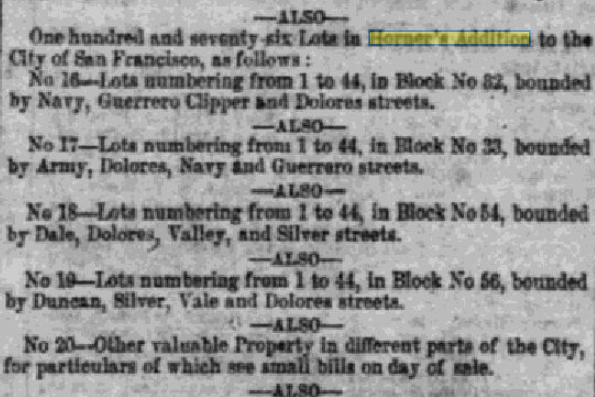
> —ALSO—
> One hundred and seventy-six Lots in Horner's Addition to the City of San Francisco, as follows:
> No 16—Lots numbering from 1 to 44, in Block No 32, bounded by Navy, Guerrero Clipper and Dolores streets.
> —ALSO—
> No 17—Lots numbering from 1 to 44, in Block No 33, bounded by Army, Dolores, Navy and Guerrero streets.
> —ALSO—
> No 18—Lots numbering from 1 to 44, in Block No 54, bounded by Dale, Dolores, Valley, and Silver streets.
> —ALSO—
> No 19—Lots numbering from 1 to 44, in Block No 56, bounded by Duncan, Silver, Vale and Dolores streets.
"Advertisement." Daily Placer Times and Transcript (San Francisco, California) V, no. 1181, January 30, 1854: [3]. NewsBank: San Francisco Chronicle Historical Archive. <https://infoweb-newsbank-com.ezproxy.sfpl.org/apps/news/document-view?p=EANX-NB&docref=image/v2%3A11B56327F72F7EE7%40EANX-NB-11BE41D774A0E680%402398249-11BE41D7A3999620%402-11BE41D85EA93670%40Advertisement>.

[Daily Placer Times and Transcript - March 31, 1854](https://infoweb-newsbank-com.ezproxy.sfpl.org/apps/news/document-view?p=EANX-NB&t=&sort=YMD_date%3AA&fld-base-0=alltext&maxresults=20&val-base-0=%22horner%27s%20addition&docref=image/v2%3A11B56327F72F7EE7%40EANX-NB-11BE421B52BC3038%402398309-11BE421B6DB074F8%401-11BE421BCB82BB48%40Advertisement)
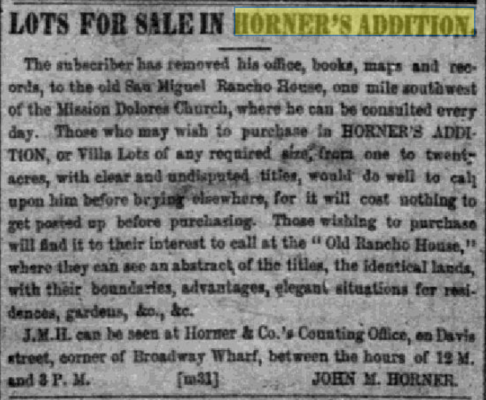
> LOTS FOR SALE IN HORNER'S ADDITION.
> The subscriber has removed his office, books, maps and records, to the old San Miguel Rancho House, one mile southwest of the Mission Dolores Church, where he can be consulted every day. Those who may wish to purchase in HORNER'S ADDITION, or Villa Lots of any required size, from one to twenty acres, with clear and undisputed titles, would do well to call upon him before buying elsewhere, for it will cost nothing to get posted up before purchasing. Those wishing to purchase will find it to their interest to call at the " Old Rancho House," where they can see an abstract of the titles, the identical lands, with their boundaries, advantages, elegant situations for residences, gardens, &c., &c.
> J.M.H. can be seen at Horner & Co.'s Counting Office, on Davis street, corner of Broadway Wharf, between the hours of 12 M. and 3 P. M.                          JOHN M. HORNER.
"Advertisement." Daily Placer Times and Transcript (San Francisco, California) V, no. 1233, March 31, 1854: [2]. NewsBank: San Francisco Chronicle Historical Archive. <https://infoweb-newsbank-com.ezproxy.sfpl.org/apps/news/document-view?p=EANX-NB&docref=image/v2%3A11B56327F72F7EE7%40EANX-NB-11BE421B52BC3038%402398309-11BE421B6DB074F8%401-11BE421BCB82BB48%40Advertisement>.

[Daily Alta California, Volume 5, Number 142, 23 May 1854](https://cdnc.ucr.edu/?a=d&d=DAC18540523.2.16.5&srpos=3&e=--1853---1865--en--20-DAC-1-byDA-txt-txIN-horner+noe-------)
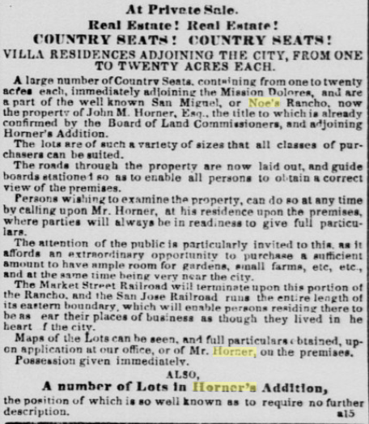
> At Private Sale. Real Estate! Real Estate! COUNTRY SEATS ! COUNTRY SEATS ! VILLA RESIDENCES ADJOINING THE CITY, FROM ONE TO TWENTY ACRES EACH. A large number of Country Seats, confining from one to twenty acres each, immediately adjoining the Mission Dolores, and are a part of the well known San Miguel, or Noe's Rancho, now the property of John M. Homer, Esq. the title to which is already confirmed by the Board of Land Commissioners, and adjoining Homer's Addition. The lots are of seen a variety of sizes that all classes of purchasers can be suited. The roads through the property are now laid out, and guide boards stationed so as to enable all persons to obtain a correct view of the premises. Persons wishing to examine th» property, can do so at any time by calling upon Mr. Homer, at his residence upon the premises, where parties will always be in readiness to give full particulars. The attention of the public is particularly invited to this, as it affords an extraordinary opportunity to purchase a sufficient amount to have ample room for gardens, small farms, etc., etc., and at the same time being very near the city. The Market Street Railroad will terminate upon this portion of the Rancho, and the San Jose Railroad runs the entire length of its eastern boundary, which will enable persona residing there to be as near their places of business as though they lived in the heart of the city. Maps of the Lots can he seen, and full particulars obtained, upon application at our office, or of Mr. Horner, on the premises. Possession given immediately. ALSO, A number of Lots in Horner's Addition, the position of which is so well known as to require no further description.

These ads run until the end of January 1855.

But in the interim, the Panic begins:
[Daily Alta California, Volume 5, Number 320, 18 November 1854](https://cdnc.ucr.edu/?a=d&d=DAC18541118.2.20.1&srpos=5&e=--1852---1865--en--20-DAC-1-byDA.rev-txt-txIN-horner+robinson-------)
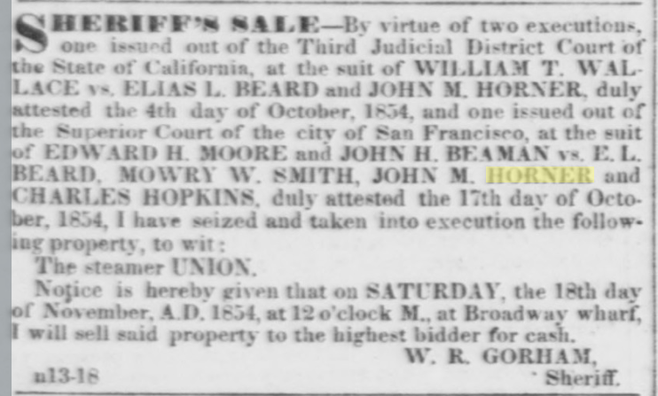

Huh I guess it took awhile to get this sorted out...
[Daily Alta California, Volume 5, Number 335, 4 December 1854](https://cdnc.ucr.edu/?a=d&d=DAC18541204.2.17.1&srpos=20&e=-------en--20-DAC-1-byDA.rev-txt-txIN-horner+gorham-------)
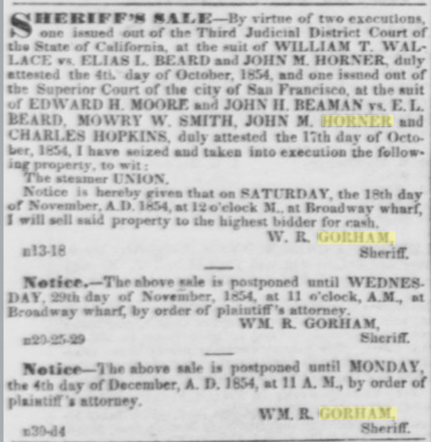

and then, I guess it wasn't enough?
[Daily Alta California, Volume 6, Number 8, 9 January 1855](https://cdnc.ucr.edu/?a=d&d=DAC18550109.2.21.5&srpos=15&e=-------en--20-DAC-1-byDA.rev-txt-txIN-horner+gorham-------)
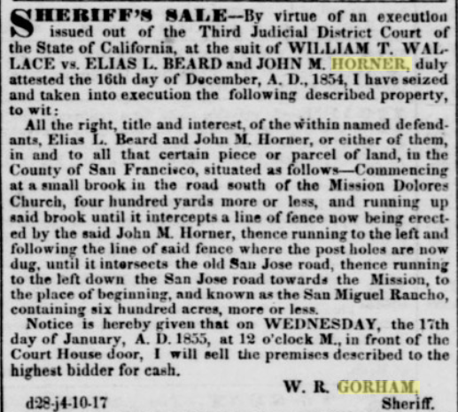

Hmm, and this appears on Feb 1, nominally the day after...?
[Daily Alta California, Volume 6, Number 31, 1 February 1855](https://cdnc.ucr.edu/?a=d&d=DAC18550201.2.20.2&srpos=4&e=-------en--20-DAC-1-byDA.rev-txt-txIN-horner+gorham-------)
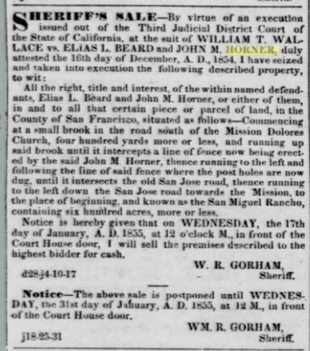

Ah dang, here it is...
[Daily Alta California, Volume 6, Number 317, 15 April 1855](https://cdnc.ucr.edu/?a=d&d=DAC18550415.2.19.6&srpos=16&e=--1852---1865--en--20-DAC-1-byDA-txt-txIN-horner+noe-------)
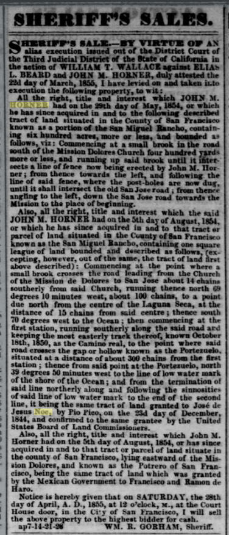
> SHERIFF'S SALE - By VIRTUE OF AN alias execution issued out of th*District Court of the Third Judicial District of the State of California in the action of WILLIAM T. WALLACE against ELIAS L. BEARD and JOHN M. HORNER, duly attested the 22d day of March, 1855, I have levied on and taken into execution the following property, to wit :
> All the right, title and interest which JOHN. M. HORNER had oa the 29th day of May, 1854, or which he ha* since acquired in aad to the following described tract of Und situated in the County of San Francisco known as a portion of the San Miguel Rancho, containing six hundred acre*, more or less, bad bounded as follows, viz: Commencing at a small brook la the road south of the Mission Dolores Church four hundred yard more or less, and running up said brook until it intersects a line of fence now being erected by John M. Homer ; from thence towards the left, and following the line of said fence, where the post-holes are now dug. until it shall intersect the old San Jose road ; from there angling to the left, down the San Jose road towards the Mission to th*place of beginning.  
> Also, all the right, title and interest which the said JOHN M. HORNER had on the 5th day of August, 1854, or which he has since acquired in and to that tract ax parcel of land situated in the County of San Francisco known as the San Miguel Rancho, containing one square league of land bounded and described a* follows, (excepting, however, out of the same, the tract of land first above described): Commencing at tbe point where a small brook crosses the road leading from the Church of the Mission de Dolores to San Jose about 14 chains southerly from said Church, running thence north 69 degrees 10 minute west, about IUO chain*, to a point due north from the centre of the Laguna Seea, at the distance of IS chains from said centre ; thence south 70 degrees west to the Ocean ; then commencing at the first station, running southerly along the said road acd keeping the most easterly track thereof, known October 18th, 1850, as the Camino real, to the point where said road crosses the gap or hollow known a* the Portezuelo. situated at a distance of about 300 chains from the nrtt station ; thence from said point at the Portexuelo, north 39 degrees 50 minutes west to the line of low water mark of the shore of the Ocean ; and from the termination of said line northerly along and following the sinnositir> of said line of low water mark to the end of the second live, it being the name tract of Und granted to Jose de Jesus Noe, by Pio Pico, on the S3d day of December, 1844, and confirmed to the same grantee by the United States Board of Land Commissioners.
> Also, all the right, title and interest which John M. Homer had on the sth day of August, 1854, or bas since acquired in and to that tract or parcel of land situate in the county of San Francisco, lying eastward of the Mission Dolores, and known as the Potrero of San Francisco, being the same tract of Und which was granted by the Mexican Government to Francisco aud Ramon de Haro. Notice is hereby given that on BATURDAY, the 28th day of April, A. D., 1855, at 12 o'clock, at the Court House door, in the City of San Francisco, I will sell the above property to the highest bidder for cash.
>
> - WM. R. GORHAM, Sheriff

Presumably Pioche and Robinson bought it, or the remaining parts of it, on that day.

[San Francisco Bulletin - December 31, 1862](https://infoweb-newsbank-com.ezproxy.sfpl.org/apps/news/document-view?p=EANX-NB&t=&sort=YMD_date%3AA&page=4&fld-base-0=alltext&maxresults=20&val-base-0=%22horner%27s%20addition&docref=image/v2%3A113ACFC4DAF84818%40EANX-NB-117B344D19857668%402401506-117B344D8025E338%402-117B344ED95A8A20%40Delinquent%2BTax%2BSale)
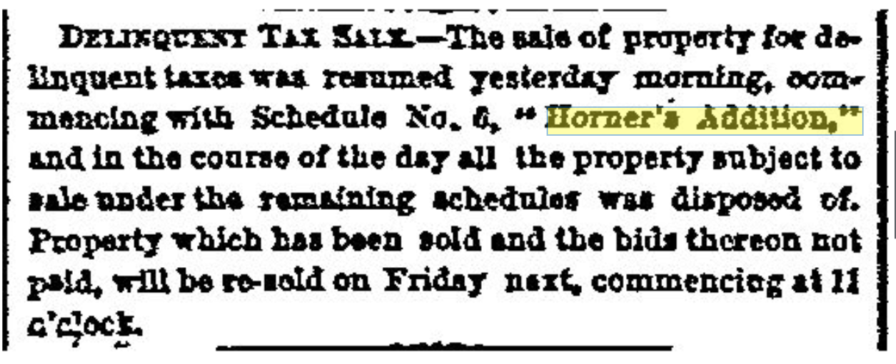
> DELINQUENT TAX SALE.—The sale of property for delinquent taxes was resumed yesterday morning, commencing with Schedule No. 6, "Horner's Addition," and in the course of the day all the property subject to sale under the remaining schedules was disposed of. Property which has been sold and the bids thereon not paid, will be re-sold on Friday next, commencing at 11 o'clock.
"Delinquent Tax Sale." <em>San Francisco Bulletin</em> (San Francisco, California) XV, no. 71, December 31, 1862: [3]. <em>NewsBank: San Francisco Chronicle Historical Archive</em>. <https://infoweb-newsbank-com.ezproxy.sfpl.org/apps/news/document-view?p=EANX-NB&docref=image/v2%3A113ACFC4DAF84818%40EANX-NB-117B344D19857668%402401506-117B344D8025E338%402-117B344ED95A8A20%40Delinquent%2BTax%2BSale>.
