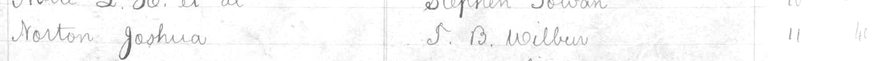
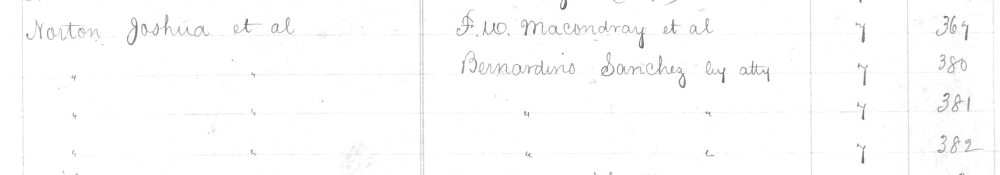
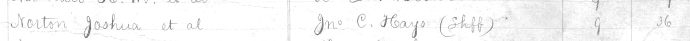

"California, San Francisco County Records, 1824-1997," database with images, FamilySearch (<https://familysearch.org/ark:/61903/3:1:33SQ-G5D3-F9R?cc=1402856&wc=319V-RMW%3A20726201%2C20821501> : 20 May 2014), Land and Property Records > Deed Index, Vol. 02, A-Z, 1850 > image 265 of 412; San Francisco Public Library, California.
